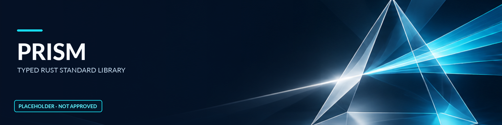

*Illustrative placeholder artwork, pending UOR Foundation brand approval.*

# Prism

[](https://github.com/UOR-Foundation/prism/actions/workflows/ci.yml)
[](https://github.com/UOR-Foundation/prism/actions/workflows/docs.yml)
[](https://github.com/UOR-Foundation/prism/releases)
[](LICENSE)

**Build software with UOR's building blocks, without assembling them one by one.**

[Why Prism](#why-prism-exists) · [Quick start](#quick-start) ·
[Crate map](#crate-map) · [Verification](#verification) ·
[Contributing](#contributing)

## Why Prism exists

Building on a shared framework should not mean hunting through different
libraries to find the pieces that work together. Rust developers using the
[UOR Framework](https://github.com/UOR-Foundation/uor-framework) need ways
to describe data, connect operations, and check how results were produced.
Combining those pieces by hand adds setup work and makes it harder to know
which interfaces are meant to fit together.

**Prism brings the UOR building blocks into one place.** It gives Rust
applications a common starting point for working with UOR's data models,
numerical tools, cryptography, and other supported operations.

Think of Prism as a **toolkit for developers building with UOR**, not an app
you sign in to. It gives you the parts and interfaces; you decide what
your application does with them.

## What it is

This repository maintains the Rust library published as `uor-prism`.
Applications use the import name `prism` to access its public interfaces.
Behind that single entry point are the UOR foundation and separate
libraries for specialized operations.

Prism follows the architecture recorded in the
[UOR-Framework wiki][wiki], particularly [ADR-031][adr-031].
Its goal is to make supported UOR capabilities easier to use together.
**A successful build is not proof that every application using Prism is
correct or secure.** The [verification section](#verification) explains
the checks that actually run.

## Contents

- [Why Prism exists](#why-prism-exists)
- [What it is](#what-it-is)
- [What Prism provides](#what-prism-provides)
- [Quick start](#quick-start)
- [Crate map](#crate-map)
- [How it fits together](#how-it-fits-together)
- [Verification](#verification)
- [Releases and compatibility](#releases-and-compatibility)
- [Contributing](#contributing)
- [License](#license)

## What Prism provides

- **One application dependency:** the `prism` façade exposes foundation
  pipeline types, `prism_model!` and related SDK macros, standard shapes,
  and four built-in axis families.
- **Typed composition:** application authors use the foundation's model,
  shape, route, and admission contracts. The compiler checks the declared
  interfaces; running a test or compiling a model does not prove every
  possible model correct.
- **Independent replay surface:** `uor-prism-verify` exposes trace-replay
  certification separately from application execution.

For example, the façade makes these public imports available:

```rust
use prism::pipeline::{prism_model, run_route};
use prism::crypto::Sha256Hasher;
use prism::numerics::BigInt256Numeric;
```

These are imports, **not** a complete executable `PrismModel`. A complete
model also supplies the appropriate shapes, route, host types, and any
resolvers or commitments its application needs. See the
[model contract tests](crates/uor-prism/tests/prism_model.rs) and
[route tests](crates/uor-prism/tests/stdlib_route_publication.rs) rather
than treating a three-line import as an end-to-end example.

## Quick start

### 1. Inspect a working source-checkout test

Prerequisites: Git, Cargo, and the Rust toolchain. The repository pins
**Rust 1.85** in [`rust-toolchain.toml`](rust-toolchain.toml). From a terminal:

```sh
git clone https://github.com/UOR-Foundation/prism.git
cd prism
cargo test -p uor-prism --test stdlib_primitives
```

This exercises real built-in shape admission and type metadata tests.
A successful run ends with a passing Cargo test summary. It validates
the **checked-out source**, not a published downstream installation.

### 2. Use the library from a small Rust application

From the directory **containing** the cloned `prism/` folder, create
a sibling application. The path dependency deliberately uses your
local checkout so this example does not assume a particular version
has already propagated through crates.io:

```sh
cargo new prism-first-steps
cd prism-first-steps
cargo add uor-prism --path ../prism/crates/uor-prism
```

Replace `prism-first-steps/src/main.rs` with:

```rust
use prism::pipeline::{validate_constrained_type, ConstrainedTypeShape};
use prism::std_types::U32;

fn main() {
    validate_constrained_type(U32).expect("the built-in U32 shape is admissible");
    println!("U32 site count: {}", <U32 as ConstrainedTypeShape>::SITE_COUNT);
}
```

Run `cargo run` from `prism-first-steps/`. The expected output is:

```text
U32 site count: 4
```

The public imports, `U32` admission, and four-site count are covered by
[`stdlib_primitives.rs`](crates/uor-prism/tests/stdlib_primitives.rs).
**Evidence boundary:** this standalone copy-and-run sequence has not
been independently exercised as a consumer acceptance test in this
README change. It demonstrates shape admission, **not** a full route,
certificate, or verified cryptographic application. Cargo may need
network access to resolve transitive dependencies.

For published dependencies, use
[`uor-prism` on crates.io](https://crates.io/crates/uor-prism)
and select a version available in the registry. Its Cargo package
name is `uor-prism`; its Rust import name is `prism`. The
[versioned API documentation](https://docs.rs/uor-prism) may list a
different release from the latest GitHub tag, so check the version you
actually installed.

## Crate map

The six published-package *targets* come from
[the workspace manifest](Cargo.toml). Application authors normally
depend on the façade alone; the verifier is a separate dependency
for replay consumers.

| Cargo package | Rust import | Purpose |
| --- | --- | --- |
| [`uor-prism`](crates/uor-prism/) | `prism` | Standard-library façade: foundation types, SDK macros, and all Layer-3 sub-crates |
| [`uor-prism-verify`](crates/uor-prism-verify/) | `prism_verify` | Independent trace-replay and certification façade (ADR-005) |
| [`uor-prism-crypto`](crates/uor-prism-crypto/) | `prism_crypto` | `HashAxis` (SHA-2/3, BLAKE3, Keccak), `CurveAxis`, `SignatureAxis`, `CommitmentAxis` |
| [`uor-prism-numerics`](crates/uor-prism-numerics/) | `prism_numerics` | `BigIntAxis`, `FixedPointAxis`, `FieldAxis` (secp256k1 base), `RingAxis` (GF(2)) |
| [`uor-prism-tensor`](crates/uor-prism-tensor/) | `prism_tensor` | `TensorAxis`, `ActivationAxis` with CPU integer-precision references |
| [`uor-prism-fhe`](crates/uor-prism-fhe/) | `prism_fhe` | `FheAxis` with a one-time-pad reference implementation |

The substrate crates
[`uor-foundation`](https://crates.io/crates/uor-foundation) and
[`uor-foundation-sdk`](https://crates.io/crates/uor-foundation-sdk)
are consumed as normal registry dependencies, not vendored or forked
here. The `fhe` package's one-time-pad reference is **not** a claim
of production homomorphic-encryption security.

## How it fits together

```text
Your Rust application
        |
        v
uor-prism (import: prism)
        |
        +-- foundation pipeline, shapes, and SDK macros
        +-- crypto / numerics / tensor / fhe axes
        |
        v
uor-foundation (external substrate)

Separate verifier: uor-prism-verify -> trace replay
```

The [UOR-Framework wiki][wiki] is the **normative** architecture in
arc42 and C4 form. The source implementation is documented in rustdoc.
Every public item is expected to backlink to its wiki definition, and
the [wiki-link checker](tools/wiki-link-check/) is run in CI. For
repository layout, permitted scope, release rules, documentation
conventions, and CI policy, consult [`AGENTS.md`](AGENTS.md).
Local [documentation assets](docs/README.md) are illustrative; they
do not supersede the wiki.

## Verification

The repository's [CI workflow](.github/workflows/ci.yml) runs separate
checks for Rust formatting, Clippy, workspace tests, `no_std` builds,
rustdoc, wiki links, and dependency policy (`cargo deny`). These are
source/repository checks, not proofs that a specific downstream
application is safe or that a published artifact was installed.

| Contributor goal | Existing command |
| --- | --- |
| Build the workspace | `cargo build --workspace` or `just dev` |
| Run all workspace tests | `cargo test --workspace --all-features` or `just test` |
| Check formatting, Clippy, rustdoc and wiki links | `just lint` |
| Validate wiki backlinks only | `just lint-wiki` |
| Check `no_std` configurations | `just no-std` (requires the configured target) |
| Inspect generated API docs | `just doc` or `just doc-open` |

All `just` recipes are defined in [`justfile`](justfile). A green
CI badge reflects that workflow on `main` only. It does not imply
passing consumer acceptance, current published-registry availability,
or a security certification.

## Releases and compatibility

The [GitHub releases](https://github.com/UOR-Foundation/prism/releases)
record tagged source releases and the six-crate publishing contract.
The currently inspected workspace declares **`0.4.3`** in
[`Cargo.toml`](Cargo.toml); check the releases page and
[crates.io](https://crates.io/crates/uor-prism) for what is available
when you install. A GitHub release note and a registry publication
are distinct evidence. The pinned **Rust 1.85** toolchain applies to
this repository checkout; see crate manifests and dependency
constraints when evaluating downstream compatibility.

## Contributing

Start with [CONTRIBUTING.md](CONTRIBUTING.md) for development commands
and [AGENTS.md](AGENTS.md) for the required five-block public-item
documentation structure, architectural constraints, and acceptance
rules. Architecture changes belong in the [UOR-Framework wiki][wiki],
not in an unreviewed README edit. Proposed library changes should
include focused behavioral tests and conform to the existing gates.

## License

MIT. See [LICENSE](LICENSE).

[wiki]: https://github.com/UOR-Foundation/UOR-Framework/wiki
[adr-031]: https://github.com/UOR-Foundation/UOR-Framework/wiki/09-Architecture-Decisions
